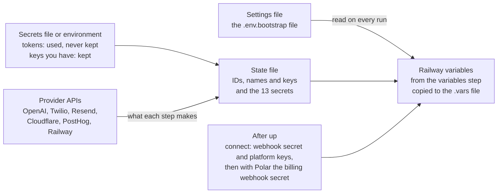

# Bootstrap script variables: a data dictionary

**Status:** checked on 12 November 2026 against `devops/bootstrap.mjs` on `releases/r2` at `4711924` plus fork PR #157, with which `up` reads the Polar organization from the worker's token and `connect` sets Polar's plans up. The PostHog settings, token, state values and variables were added on 13 November 2026, checked against fork PR #165, with which `up` finds or makes a PostHog project. The copy on `main` (last changed 2 November) has no Stripe support, no `BILLING_PROVIDER`, `STRIPE` or `POSTHOG` settings, no PostHog step, and no billing in `connect`.

## How to read this

You give the bootstrap script 33 settings and up to 7 provider tokens. It finds or makes everything else, records it in a state file, and writes about 100 variables onto five Railway services: 103 for a cloud test deployment on Polar with PostHog, and 3 more from `connect`. [`devops/bootstrap.md`](../../devops/bootstrap.md) says how to run it; this page says what each value is, where it comes from and how it is checked.

Settings are read on every run, and everything a step makes is kept in the state file. Provider tokens stop at the script. Constants such as `NODE_ENV=production` and the `${{…}}` references come from the script itself and go straight onto Railway.

**Which source wins.** Once a step is done, its values come from the state file. The secrets file is read again only for a step you `redo`, which is why a new Polar token needs `redo … polar.tokens`.

| Kind of value | Read from, first match wins | Kept in the state file |
| --- | --- | --- |
| Settings | The settings file. A key set twice: the last line wins. Empty: the default | No, read on every run |
| Provider tokens (below) | Environment variable, then secrets file, then asked with typing hidden | Never |
| Polar setup token (`POLAR_SETUP_TOKEN`), for `connect` when the deployment's own token can't set the plans up | Environment variable, then secrets file, then asked with typing hidden | Never |
| Polar tokens, Stripe keys, OpenAI webhook secret | Environment variable, then secrets file, then asked | Yes, once their step is done |
| Polar webhook secret | The file `pnpm billing apply` writes for `connect`, then Polar's list of webhooks, read with the token `connect` gave `pnpm billing`. Polar's wins | Yes |
| Things you already have (below) | Secrets file only, never the environment. Absent: the script makes them | Yes |
| The 13 platform secrets | State file, then secrets file, then the value already on Railway, then new random | Yes |
| Everything else a step found or made | The step itself, through the provider's API | Yes |

**The files.** All of them sit in the repository folder, and Git ignores them all (`.env.*` and `.platform-keys/`).

| File | Holds | Written by | Secret |
| --- | --- | --- | --- |
| `.env.bootstrap-<name>` | The settings | You (`init` writes a template) | No |
| `.env.bootstrap-<name>.secrets` | Provider tokens and things you already have | You | Yes |
| `.env.bootstrap-<name>.state.json` | Each step's result: IDs, names, the 13 platform secrets, provider keys, and with Polar the billing webhook's secret. Never the setup token or the operator key | The script | Yes |
| `.env.bootstrap-<name>.vars` | Every service's Railway variables, in `railway-vars.mjs` format | The `variables` step | Yes |
| `.env.bootstrap-<name>.log` | Each run's output and API calls, secrets shown as ‹hidden› | The script | No |
| `.platform-keys/<prefix>.json` | The operator's platform key | `connect` | Yes |
| `.env.stripe-<name>`, or for Polar the file you name | Billing webhook secrets, until Railway has them | `pnpm billing apply`, when you run it yourself. `connect` has it write into a temporary folder only you can read, and deletes the folder | Yes |

## Settings

The settings file `.env.bootstrap-<name>` holds nothing secret, one `KEY=value` per line. The script checks it on every command and stops with `<file> needs fixing` and a list. Rules not met below mean that stop, unless it says warning.

| Setting | Required | Default | Rule | What it drives |
| --- | --- | --- | --- | --- |
| `NAME` | Only without `APP_BASE_URL`, or when its address is over 50 characters | None | Lower case letters, digits and dashes, starting with a letter or digit (`^[a-z0-9][a-z0-9-]*$`). No dots | The fallback name for what is made at providers, and the command line's profile name |
| `BRAND` | Yes | None | A folder `brands/<BRAND>` with `brand.json` on `BRANCH` (checked by `doctor` and the `github.brand` step through `gh`). In cloud mode it also needs `billing.json` | `BRAND_PRESET`, and which `billing.json` `pnpm billing` sells |
| `ENVIRONMENT` | No | `test` | `test` or `production`. Production needs `APP_BASE_URL` on a domain `brands/index.json` gives the brand | Production adds `REQUIRE_EMAIL_VERIFICATION=true` and sets no `BRAND_PRESET` |
| `REPO` | Yes | None | `owner/name` | The fork Railway builds |
| `BRANCH` | No | `main` | Railway's GitHub app must reach `REPO`, or pushes won't redeploy (`up` warns) | The branch every push redeploys |
| `DEPLOYMENT_MODE` | No | `self_hosted_standard` | `self_hosted_standard` or `cloud` | `cloud` turns on billing and the Polar or Stripe values |
| `OPERATOR_EMAIL` | Yes | None | Not empty (no format check) | Owns the platform key, signs up first, gets DMARC reports |
| `RAILWAY_WORKSPACE_ID` | Yes, until the project exists | None | No format check. `doctor` says FIX when it is empty and lists the workspaces the token reaches | The workspace the project is made in |
| `RAILWAY_TEMPLATE` | No | Empty | The code `template` printed | `up` makes the services, volumes and settings in one call |
| `TEMPLATE_PROJECT` | No | `lobbystack-template` | Read only by `template` | The project the template is built from |
| `TEMPLATE_REPO` | No | `REPO` | `owner/name` | The repository that project's services point at |
| `BUCKET_REGION` | No | `iad` | `sjc`, `iad`, `ams` or `sin`. Can't change later | The bucket's region |
| `APP_BASE_URL` | Only in production | Empty: Railway's address | A host such as `demo.example.com`, `https://` allowed, no path. Inside `CLOUDFLARE_ZONE` when that is set. Not on a domain `brands/index.json` gives another brand | Names (when 50 characters or less), the custom domain and CNAME, the Turnstile widget, the admin's `APP_BASE_URL` and `AUTH_TRUSTED_ORIGINS` |
| `CUSTOM_HOST` | No | Empty | The older name of `APP_BASE_URL`. Both set to different addresses: refused | Same as `APP_BASE_URL` |
| `EMAIL_DOMAIN` | While `STEP_RESEND` is on | None | Inside `CLOUDFLARE_ZONE` when that is set | The Resend domain and its DNS records |
| `EMAIL_FROM` | Yes | None | Not empty | The worker's `EMAIL_FROM` |
| `RESEND_REGION` | No | `us-east-1` | `us-east-1`, `eu-west-1`, `sa-east-1` or `ap-northeast-1`. Can't change later | The Resend domain's region |
| `CLOUDFLARE_ZONE` | No | Empty: DNS records are printed for you to add | The zone's domain name, never its 32-character Zone ID | Where the CNAME and email records are written |
| `CLOUDFLARE_ACCOUNT_ID` | No | Empty: you make the Turnstile widget by hand | 32 hex characters | The Turnstile widget made by API |
| `TWILIO_TOLLFREE` | No | Empty: none | Cloud mode only. `buy`, or a number in the subaccount in `+` and 8 to 15 digits | `TWILIO_ALERT_SMS_FROM` on the admin and the worker |
| `BILLING_PROVIDER` | No | `polar` | `polar` or `stripe`. `stripe` only in cloud mode | Which provider's values go on Railway |
| `POLAR_ORGANIZATION_ID` | No | Empty: the organization the worker's Polar token belongs to | Empty, or the organization's ID, a UUID. Set, `up` stops when the worker's token belongs to another organization, and `doctor` marks FIX | `POLAR_ORGANIZATION_ID` on the admin and the worker, through the state file |
| `POLAR` | No | `sandbox` | `sandbox` or `live` | `sandbox` adds `POLAR_API_BASE_URL=https://sandbox-api.polar.sh` |
| `STRIPE` | No | `sandbox` | `sandbox` or `live`. Each Stripe key must be of that mode | Which Stripe keys are accepted |
| `POSTHOG` | No | `us` | `us`, `eu`, a self-hosted PostHog's `https://` address with no path, or `no` (or `false`, `off`, `0`). A deployment `up` deployed before the PostHog step gets PostHog only once the file has this line, since adding it redeploys migrate, the admin and the worker | Where the PostHog project is found or made, and the address events and logs go to. `no` sets no PostHog value |
| `POSTHOG_ORGANIZATION_ID` | Only when the personal API key reaches several organizations | Empty: the one organization the key reaches | Empty, or a UUID among the key's organizations, which `doctor` and `up` list when the key reaches several | The organization the project is found or made in |
| `POSTHOG_PROXY` | No | Empty: PostHog's own address | A reverse proxy's `https://` address with no path, such as PostHog's managed proxy, which ad blockers don't stop | The admin's `NEXT_PUBLIC_POSTHOG_HOST`. The worker's events and the logs still go straight to PostHog |
| `POSTHOG_RECORDINGS` | No | `yes` | Like the `STEP_…` settings | `yes` turns the project's screen recordings on, and `post.posthog` lets them come only from the deployment's addresses. `no` leaves the project's recordings as they are |
| `POSTHOG_LOGS` | No | `yes` | Like the `STEP_…` settings | `yes` sends migrate's, the admin's and the worker's logs, traces and metrics to the project. `no` leaves the `OTEL_…` variables to you, such as for another log service |
| `STEP_GITHUB`, `STEP_OPENAI`, `STEP_TWILIO`, `STEP_RESEND`, `STEP_TURNSTILE` | No | `yes` | `yes`, `no`, `true`, `false`, `on`, `off`, `1` or `0` | `no` skips that provider's API: its values come from the secrets file or are asked for |

**How the file is read.** A line starting with `#` is ignored, and a comment after a value becomes part of the value. Quotes around a value are dropped. A line without `=` is refused. A key set twice to different values gives a warning, and the last line wins. A key the script doesn't know gives a warning, usually a misspelling.

## Provider tokens

These seven let the script create things at each provider. Each is read from the environment variable of the same name, then the secrets file, then asked with typing hidden. None is saved in the state file or put on Railway, so delete them from the secrets file once the environment works.

| Token | What it must be | Where to make it | Needed until | How it's checked |
| --- | --- | --- | --- | --- |
| `RAILWAY_API_TOKEN` | An account token, or a workspace token for `RAILWAY_WORKSPACE_ID`. A project token can't create projects | railway.com/account/tokens | Always: every Railway step uses it | `doctor` reads the workspace with it |
| `OPENAI_ADMIN_KEY` | An admin key (`sk-admin-…`), which only an organization owner can make | platform.openai.com/settings/organization/admin-keys | The OpenAI project and key exist, or are given, or `STEP_OPENAI=no` | `doctor` lists the projects and stops when two active ones share the name |
| `TWILIO_MAIN_ACCOUNT_SID`, `TWILIO_MAIN_AUTH_TOKEN` | The main account, which owns the subaccounts, upgraded from trial | Twilio console, Account Info | The subaccount exists, or is given, or `STEP_TWILIO=no` | `doctor` reads the account; a trial account is refused |
| `RESEND_ADMIN_KEY` | A Full access key (a Sending access key can't create domains or keys) | resend.com/api-keys | The sending key exists, or `SMTP_PASSWORD` is given, or `STEP_RESEND=no` | `doctor` lists the domains |
| `CLOUDFLARE_API_TOKEN` | Zone > DNS > Edit on the zone, and Account > Turnstile > Edit | dash.cloudflare.com/profile/api-tokens | Always, while `CLOUDFLARE_ZONE` is set or the widget is made by API | `doctor` finds the zone by name and reads the widgets |
| `POSTHOG_PERSONAL_API_KEY` | A personal API key (`phx_…`) made in the region `POSTHOG` names, since each region knows only its own keys, with `organization:read`, `project:read` and `project:write`, and the organization in its scope. Making a project takes an admin of the organization, unless it lets members make them | us.posthog.com/settings/user-api-keys, or eu.posthog.com | `posthog.project` and `post.posthog` are done, or `POSTHOG_PROJECT_TOKEN` is given, or `POSTHOG=no` | `doctor` reads the organization and its projects, and says whether `up` can make the project: the plan's project limit, and whether you are an admin |

**Also read on your computer.** `HTTPS_PROXY` with `NODE_USE_ENV_PROXY=1` behind a proxy. The GitHub CLI `gh`, signed in as the fork's owner, checks the workflows and the brand folder; without it those checks are by hand. The Railway CLI makes the bucket; without it that is by hand too. Never set `BOOTSTRAP_APP_URL`, `BOOTSTRAP_POLL_MS`, `BOOTSTRAP_RAILWAY_CLI` or the `BOOTSTRAP_*_URL` values: they point the script at test stand-ins.

## Things you already have

Each of these, given in the secrets file, is used instead of making a new one, and that provider's token isn't needed for it. They come from the secrets file only, except the Polar tokens, the Stripe keys and the webhook secret, where an environment variable of the same name wins.

| Key | Rule | Used instead of | Goes on Railway as |
| --- | --- | --- | --- |
| `OPENAI_PROJECT_ID`, `OPENAI_API_KEY` | Both or neither: given one, the script asks for the other. The ID is `proj_…` | Making the OpenAI project and its key | The admin's `OPENAI_API_KEY`, which the worker refers to. The project ID never goes on Railway |
| `TWILIO_ACCOUNT_SID`, `TWILIO_AUTH_TOKEN` | `AC` and 32 characters, with that account's Auth Token. `doctor` checks the pair | Making the subaccount | The admin's `TWILIO_ACCOUNT_SID` and `TWILIO_AUTH_TOKEN`, which the worker refers to |
| `TWILIO_SIP_TRUNK_SID` | `TK` and 32 characters, a trunk in that account | Making the SIP trunk | The worker's `TWILIO_SIP_TRUNK_SID` |
| `SMTP_PASSWORD` | Resend's sending key, `re_…` | Making the sending key | The worker's `SMTP_PASSWORD` |
| `TURNSTILE_SITE_KEY`, `TURNSTILE_SECRET_KEY` | Both. `post.turnstile` adds the deployment's addresses to that widget | Making the widget | The admin's `NEXT_PUBLIC_TURNSTILE_SITE_KEY` and `TURNSTILE_SECRET_KEY` |
| `POLAR_ADMIN_TOKEN`, `POLAR_WORKER_TOKEN` | Cloud mode with Polar, both made in the deployment's organization. Admin: `customer_sessions:write`. Worker: `checkouts:write`, `events:write`, `organizations:read`, `meters:read`, `products:read`, `discounts:read`, `subscriptions:write`, `customers:write`. One token with all nine works for both. Guide 3.7 gives neither `webhooks:read`. With the five setup scopes as well (`organizations:write`, `meters:write`, `products:write`, `discounts:write`, `webhooks:write`), the worker's token also sets the plans up in `connect`, which then asks for no setup token, and the worker can then change the plans and read the webhook's secret. `doctor` and `polar.tokens` read the organization the worker's token belongs to; the admin's can only open billing portals, so nothing checks it | Nothing: Polar makes tokens only in its dashboard | `POLAR_ACCESS_TOKEN`, on the admin and on the worker, each its own, or the same one when one token is both |
| `STRIPE_ADMIN_KEY`, `STRIPE_WORKER_KEY` | Cloud mode with Stripe. Restricted keys, `rk_test_…` in a sandbox or `rk_live_…`, of the `STRIPE` mode, both in one account. A secret `sk_` key passes, and `doctor` says a restricted one is safer | Nothing: Stripe makes restricted keys only in its dashboard | `STRIPE_API_KEY` on each service; their account becomes `STRIPE_ACCOUNT_ID` on both |
| `OPENAI_WEBHOOK_SECRET` | Starts `whsec_`. From the webhook made in the OpenAI project the trunk sends calls to | Being asked for it by `connect` | The admin's `OPENAI_WEBHOOK_SECRET` |
| `POSTHOG_PROJECT_TOKEN` | A PostHog project's token, `phc_…`. A `railway-vars.mjs` file gives it as the admin's `NEXT_PUBLIC_POSTHOG_PROJECT_TOKEN` | Finding or making the PostHog project. Its settings, such as screen recordings, stay as they are, and `post.posthog` doesn't run. Two deployments can share a project this way | The admin's `NEXT_PUBLIC_POSTHOG_PROJECT_TOKEN`, which the worker refers to, and the logs' header |
| Any of the 13 platform secrets | At least 32 letters, digits, dashes or underscores | A new random value | See the next section |

## What the state file keeps

The state file holds each finished step's result, so a later run reuses it instead of making things twice. It holds secrets: once the environment works, copy it into the password manager, with a second copy of `ENCRYPTION_KEY` and `OTP_HASH_SECRET`.

**The 13 platform secrets.** The `secrets` step settles them before any variable is set. It takes the state file's value, else the secrets file's, else the value already on Railway, else 32 random bytes written as 64 hex characters. So a lost state file never changes a running database's passwords.

| Secret | Kept on | Referred to by | Protects |
| --- | --- | --- | --- |
| `POSTGRES_PASSWORD` | Postgres | migrate's `DATABASE_URL` | The database administrator |
| `LOBBYSTACK_AUTH_PASSWORD`, `LOBBYSTACK_APP_PASSWORD`, `LOBBYSTACK_WORKER_PASSWORD`, `LOBBYSTACK_DISPATCHER_PASSWORD` | Postgres | migrate and the admin (all four), the worker (worker and dispatcher) | The four roles the services sign in as |
| `REDIS_PASSWORD` | Redis | `REDIS_URL` on the admin and the worker | Redis |
| `BETTER_AUTH_SECRET` | admin | Nothing else | Sign-in sessions |
| `ENCRYPTION_KEY` | admin | The worker | Stored keys, calendar connections, webhook secrets |
| `INTERNAL_SERVICE_SECRET` | admin | Nothing else | Short-lived signed values, such as the end of a browser call |
| `INTERNAL_SERVICE_TOKEN` | admin | The worker | The admin handing each call to the worker |
| `NUMBER_CLAIM_TOKEN_SECRET` | admin | Nothing else | The numbers a search offers |
| `OTP_HASH_SECRET` | admin | The worker | Email codes and callers' keypad PINs |
| `WIDGET_SESSION_SECRET` | admin | Nothing else | Website chat sessions |

**Where each kept value comes from.** Each value below is kept by one step, the first time it runs, and later runs take it from the state file until you `redo` that step. Most steps look first for what an earlier run kept, by its ID, and check that it still exists; then for a thing with the expected name (see Names, below), where two with that name stop the run; and make one only when there is neither. A value given in the secrets file wins over all of these, and then no name is kept. In the tables, `<name>` is the name from Names, and `<address>` the admin's address: `APP_BASE_URL`'s host, else its Railway address. `node devops/bootstrap.mjs status <settings>` lists the names in use and the steps done, and never prints a value.

**Railway.** The `railway.*` steps keep these, through Railway's API with `RAILWAY_API_TOKEN`. Railway's dashboard shows the IDs in its address bar: `railway.com/project/<project ID>/service/<service ID>?environmentId=<environment ID>`. `redo … railway.project` forgets all of them but the name, so the next `up` finds or makes the project again.

| Value | Kept by | Where it comes from | What uses it |
| --- | --- | --- | --- |
| `RAILWAY_PROJECT_ID` | `railway.project` | The project named `RAILWAY_PROJECT_NAME` in the workspace, never one being deleted. With none, Railway makes one in `RAILWAY_WORKSPACE_ID`, with the environment `ENVIRONMENT`. Kept as soon as it is known, so a run that stops halfway never makes a second | Every later Railway call |
| `RAILWAY_PROJECT_NAME` | `railway.project` | The name it was found or made with (see Names), then the name Railway shows, in case someone renamed it there | Finding the project when no ID is kept, as after `redo … railway.project` |
| `RAILWAY_ENVIRONMENT_ID` | `railway.project` | The project's environment named `ENVIRONMENT` (`test` or `production`), else its first environment | Every volume, setting, address, variable and deploy, which Railway keeps per environment |
| `RAILWAY_SERVICE_IDS` | `railway.services` | Five IDs, one per service, each found by its name in the project: `Postgres`, `Redis`, `migrate`, `admin` and `worker`, which the template made when `RAILWAY_TEMPLATE` is set. Else the step makes the service: Postgres from the image `pgvector/pgvector:pg16`, Redis from `redis:7-alpine`, and the other three empty until the `deploy.*` steps connect them to `REPO` and `BRANCH` | Each service's volume, settings, variables, address and deploy |
| `RAILWAY_HOST` | `railway.domain` | The admin's Railway address, ending `.up.railway.app`: the one it has, else one Railway makes on port 3000. `connect` asks Railway again and keeps the current one if it changed. Railway shows it under admin > Settings > Networking | `AUTH_TRUSTED_ORIGINS` beside `APP_BASE_URL`, the Turnstile widget's addresses, and `connect`'s health check while the custom address waits for DNS |
| `APP_HOST` | `railway.domain` | `APP_BASE_URL`'s host when set, else `RAILWAY_HOST`: the address `up` set the admin up on | The admin's address whenever the settings name no `APP_BASE_URL`: for the toll-free number's texts, the Turnstile widget, the webhook's URL and `connect` |
| `POST_DNS_HOST` | `post.dns`, only with `APP_BASE_URL` | The `APP_BASE_URL` host that step pointed at the deployment: its CNAME in Cloudflare, and Railway's check | `connect` compares it with `APP_BASE_URL`, and stops with the `redo` to run when the address changed after `up` |

**OpenAI.** The `openai.*` steps keep these, through OpenAI's Administration API with `OPENAI_ADMIN_KEY`. With `STEP_OPENAI=no`, `openai.manual` asks for the project ID and the key instead.

| Value | Kept by | Where it comes from | What uses it |
| --- | --- | --- | --- |
| `OPENAI_PROJECT_ID` | `openai.project` | The secrets file's `OPENAI_PROJECT_ID`, when it gives one. Else the project an earlier run kept, while it isn't archived; else the active project named `OPENAI_PROJECT_NAME`; else a new project. It starts `proj_`, and OpenAI shows it in the project's settings | The trunk's origination URI, `sip:<project ID>@sip.api.openai.com`, which sends calls to this project; the service account; and the project `connect` names for the webhook. It never goes on Railway |
| `OPENAI_PROJECT_NAME` | `openai.project` | The name of the project found or made. None when the project came from the secrets file | Finding the project when no ID is kept |
| `OPENAI_API_KEY` | `openai.key` | The secrets file, when it gives one. Else the key of a new service account named `OPENAI_ACCOUNT_NAME` in the project, which OpenAI shows only once. When that account exists already, the key is read back from the admin's `OPENAI_API_KEY` on Railway; when it isn't there either, the step asks before replacing the account, which stops its old key | The admin's `OPENAI_API_KEY`, which the worker refers to |
| `OPENAI_ACCOUNT_NAME` | `openai.key` | `<name> platform`: the service account that owns the key. None when the key came from the secrets file | Finding that account on a rerun |

**Twilio.** The `twilio.*` steps keep these, through Twilio's API with `TWILIO_MAIN_ACCOUNT_SID` and `TWILIO_MAIN_AUTH_TOKEN`. Everything after the subaccount is made inside it. With `STEP_TWILIO=no`, `twilio.manual` asks for the account and the trunk instead.

| Value | Kept by | Where it comes from | What uses it |
| --- | --- | --- | --- |
| `TWILIO_ACCOUNT_SID`, `TWILIO_AUTH_TOKEN` | `twilio.subaccount` | The secrets file, when it gives them. Else the subaccount an earlier run kept, while it isn't closed; else the open subaccount named `TWILIO_SUBACCOUNT_NAME`; else a new subaccount of the main account. Twilio returns the subaccount's Auth Token with it. The SID starts `AC`, and Twilio's console lists it among the main account's subaccounts | The admin's `TWILIO_ACCOUNT_SID` and `TWILIO_AUTH_TOKEN`, which the worker refers to. The trunk, the toll-free number and the numbers businesses buy are all in this subaccount |
| `TWILIO_SUBACCOUNT_NAME` | `twilio.subaccount` | The subaccount's name as Twilio has it. None when the account came from the secrets file | Finding it when no SID is kept |
| `TWILIO_SIP_TRUNK_SID` | `twilio.trunk` | The secrets file, when it gives one. Else the trunk an earlier run kept; else the subaccount's trunk named `TWILIO_TRUNK_NAME`; else a new trunk. A found trunk gets the guide's settings back: Secure Trunking, transfers on, and the transferee's caller ID. It starts `TK`, and Twilio's console shows it under Elastic SIP Trunking, in the subaccount | The worker's `TWILIO_SIP_TRUNK_SID`. `twilio.origination` gives the trunk one origination URI, to the OpenAI project |
| `TWILIO_TRUNK_NAME` | `twilio.trunk` | `<name> to OpenAI`, or a found trunk's own name. None when the trunk came from the secrets file | Finding it when no SID is kept |
| `TWILIO_ALERT_SMS_FROM` | `twilio.tollfree`, only with `TWILIO_TOLLFREE` | With `buy`: the number an earlier run bought, found by its name, else the first US toll-free number Twilio offers that can text, bought once you confirm. With a number: that number, which must be in the subaccount. Either way, its incoming texts go to `https://<address>/api/webhooks/twilio/sms` | `TWILIO_ALERT_SMS_FROM` on the admin and the worker |
| `TWILIO_TOLLFREE_NAME` | `twilio.tollfree` | `<name> shared texts`, only for a number the script bought | Finding that number on a rerun, so a second is never bought |

**Resend and Cloudflare.** The `resend.*` steps keep the first four, through Resend's API with `RESEND_ADMIN_KEY`. The zone is kept by the first step that writes DNS, through Cloudflare's API with `CLOUDFLARE_API_TOKEN`. With `STEP_RESEND=no`, `resend.manual` asks for the sending key instead.

| Value | Kept by | Where it comes from | What uses it |
| --- | --- | --- | --- |
| `RESEND_DOMAIN_ID` | `resend.domain` | The Resend domain named `EMAIL_DOMAIN`, else a new one in `RESEND_REGION`. Resend lists it under Domains | `resend.verify`, and the sending key, which can send from this domain only |
| `RESEND_RECORDS` | `resend.domain` | The DNS records Resend asks for, as it lists them: its SPF, DKIM and MX records | `resend.dns`, which writes them in Cloudflare, with a DMARC record when the domain has none, or lists them for you to add |
| `RESEND_KEY_NAME` | `resend.key` | The key's name, `<name>`. None when the key came from the secrets file | Finding the key on a rerun |
| `SMTP_PASSWORD` | `resend.key` | The secrets file, when it gives one. Else a new key with sending access to that domain only, which Resend shows only once. When a key with the name exists already, it is read back from the worker's `SMTP_PASSWORD` on Railway; when it isn't there either, the step asks before replacing it | The worker's `SMTP_PASSWORD` |
| `CLOUDFLARE_ZONE_ID`, `CLOUDFLARE_ZONE_NAME` | The first step that writes DNS: `resend.dns`, `railway.custom` or `post.dns` | The zone named `CLOUDFLARE_ZONE`, looked up through Cloudflare's API and kept with that name, so a changed `CLOUDFLARE_ZONE` is looked up again. Only with `CLOUDFLARE_ZONE`. Cloudflare shows the ID on the zone's Overview page | Writing the email records, the custom address's CNAME and Railway's verification record |

**Turnstile.** The `turnstile` step keeps these, through Cloudflare's API with `CLOUDFLARE_ACCOUNT_ID` and `CLOUDFLARE_API_TOKEN`.

| Value | Kept by | Where it comes from | What uses it |
| --- | --- | --- | --- |
| `TURNSTILE_SITE_KEY`, `TURNSTILE_SECRET_KEY` | `turnstile` | The secrets file, when it gives both, or typed in when you make the widget by hand (`STEP_TURNSTILE=no`, or no `CLOUDFLARE_ACCOUNT_ID`). Else the widget an earlier run kept, by its site key; else the widget named `TURNSTILE_WIDGET_NAME`; else a new Managed widget for the deployment's addresses. A found widget gets the addresses it lacks. Cloudflare shows both keys on the widget's page, under Turnstile | The admin's `NEXT_PUBLIC_TURNSTILE_SITE_KEY` and `TURNSTILE_SECRET_KEY`. `post.turnstile` finds the widget by its site key to add the addresses it lacks |
| `TURNSTILE_WIDGET_NAME` | `turnstile` | The widget's name, `<name>`. None when the keys were given or typed in | Finding the widget when no site key is kept |

**Billing, cloud mode only.** Neither Polar nor Stripe lets a script make these keys, so they come from you.

| Value | Kept by | Where it comes from | What uses it |
| --- | --- | --- | --- |
| `POLAR_ADMIN_TOKEN`, `POLAR_WORKER_TOKEN` | `polar.tokens` | The environment variable, then the secrets file, then asked. You make them in Polar, in the deployment's organization: Settings > Developers > New Token | `POLAR_ACCESS_TOKEN` on the admin and on the worker |
| `POLAR_ORGANIZATION_ID` | `polar.tokens` | Asked of Polar with the worker's token (`GET /v1/organizations/`, which lists the one organization an organization token belongs to). When the setting is set, the two must be the same | `POLAR_ORGANIZATION_ID` on both services. `doctor` and `connect` check the token for `pnpm billing` against it, a setup token or the deployment's own |
| `STRIPE_ADMIN_KEY`, `STRIPE_WORKER_KEY` | `stripe.keys` | The environment variable, then the secrets file, then asked. You make them in the deployment's Stripe account: Developers > API keys > Create restricted key | `STRIPE_API_KEY` on the admin and on the worker |
| `STRIPE_ACCOUNT_ID` | `stripe.keys` | Asked of Stripe with each key. Both keys must belong to the same account, `acct_…` | `STRIPE_ACCOUNT_ID` on both services |

**PostHog, unless `POSTHOG=no`.** The `posthog.project` step keeps these, through PostHog's API with `POSTHOG_PERSONAL_API_KEY`. It runs before the Railway steps, because the admin's first build takes the project's token. A token in the secrets file is used as it is, and then only the token and the address are kept.

| Value | Kept by | Where it comes from | What uses it |
| --- | --- | --- | --- |
| `POSTHOG_ORGANIZATION_ID` | `posthog.project` | `POSTHOG_ORGANIZATION_ID` when set, else the one organization the personal API key reaches (`GET /api/organizations/`) | Finding the project again, and `post.posthog` |
| `POSTHOG_PROJECT_ID` | `posthog.project` | The project an earlier run kept, while it is in the organization; else the project whose token the admin already has, such as one set by hand; else the project named `POSTHOG_PROJECT_NAME` (not a demo project); else a new project. PostHog shows the ID in the project's settings and in its addresses | `post.posthog`, which adds the deployment's addresses to that project's screen recording addresses |
| `POSTHOG_PROJECT_NAME` | `posthog.project` | The project's name in PostHog. None when the token came from the secrets file, or from the admin with a project outside the organization | Finding the project when no ID is kept |
| `POSTHOG_PROJECT_TOKEN` | `posthog.project` | The secrets file, when it gives one. Else the token of the project above (`phc_…`, which PostHog calls the project API key). Else, when the admin has a token whose project isn't in the organization, that token, kept as it is | The admin's `NEXT_PUBLIC_POSTHOG_PROJECT_TOKEN`, which the worker refers to, and the logs' header |
| `POSTHOG_HOST` | `posthog.project` | PostHog's address for events in the `POSTHOG` region: `https://us.i.posthog.com`, `https://eu.i.posthog.com`, or a self-hosted instance's address. When the token came from the admin, the admin's `NEXT_PUBLIC_POSTHOG_HOST` instead, so a reverse proxy set by hand stays; for a token kept as it is with no address beside it, PostHog's US address, which the dashboard then uses | The admin's `NEXT_PUBLIC_POSTHOG_HOST`, unless `POSTHOG_PROXY` is set |
| `POSTHOG_PROJECT_KEPT` | `posthog.project` | `true` when the token came from the admin and its project isn't in the organization | `status`, which then shows the project as kept from the admin's variables |

**`connect`.** Its steps keep these, after `up`.

| Value | Kept by | Where it comes from | What uses it |
| --- | --- | --- | --- |
| `OPENAI_WEBHOOK_SECRET` | `connect.webhook` | The environment variable or the secrets file, when either gives it. Else the admin's current value on Railway. Else asked, once you have made the webhook in the OpenAI project the trunk sends calls to, which shows its `whsec_` secret only once | The admin's `OPENAI_WEBHOOK_SECRET`, which `connect.variables` sets |
| `WEBHOOK_URL` | `connect.webhook` | `https://<address>/api/webhooks/openai/live`, the URL the webhook was made for | A later `connect` compares it with the admin's address now, and asks you to change the webhook's URL when the address moved |
| `PLATFORM_API_KEYS` | `connect.platformKey` | The admin's current value, read from Railway, plus a new operator entry from `pnpm platform-key:create`, unless one for `OPERATOR_EMAIL` is there already. Each entry holds a key's hash, never the key | The admin's `PLATFORM_API_KEYS`, which `connect.variables` sets |
| `PLATFORM_KEY_FILE` | `connect.platformKey` | The path of `.platform-keys/<prefix>.json`, where that command wrote the new key | `connect`'s last message, which names the file to sign the command line in with. The billing steps read the key from that file, or ask for it when the file is gone |
| `POLAR_WEBHOOK_SECRET` | `connect.billing.apply`, as soon as its `pnpm billing apply` makes the webhook, then `connect.billing.secret` | Polar's webhook to `https://<address>/api/webhooks/polar`, which `apply` makes: first from the file `apply` writes in a temporary folder, then from Polar's list of webhooks, read with the token `connect` gave `pnpm billing`. When the two differ, Polar's is used | The admin's `POLAR_WEBHOOK_SECRET`, which `connect.billing.secret` sets |

**The rest of the state file.** Beside `values`, it holds `done`, each finished step with the time it finished, which `redo` takes off, and `byHand`, the steps whose BY HAND part `--yes` didn't wait for, which run again next time. The `template` command keeps a state file of its own, `.env.bootstrap-<name>.template.state.json`, with the template project's Railway values and `TEMPLATE_CODE`, the code it prints for `RAILWAY_TEMPLATE`.

**Names.** What the script makes is named after `APP_BASE_URL`'s host when it has 50 characters or fewer, else after `NAME`: that is `<name>`. The Railway project, OpenAI project, Twilio subaccount, Resend key, Turnstile widget and PostHog project are named `<name>`, the OpenAI service account `<name> platform`, the trunk `<name> to OpenAI` and the toll-free number `<name> shared texts`. Each name is recorded the first time and kept, so changing `APP_BASE_URL` or `NAME` later renames nothing. With `APP_BASE_URL=test.example.com`, `<name>` is `test.example.com`.

## Railway variables by service

The `variables` step writes these onto the five services before their first deploy, and the same lines into the `.vars` file. On a running deployment it sets only the values that differ, and Railway redeploys each service that changed. A cloud test deployment on the Polar sandbox, on its brand's own domain, without a toll-free number and with PostHog as by default, gets 9 on Postgres (8 once the database is running), 1 on Redis, 9 on migrate, 52 on the admin and 41 on the worker. `POSTHOG=no` takes 2 from migrate and 4 each from the admin and the worker.

A value written `${{…}}` is a Railway reference, resolved when the service starts: `${{admin.X}}` copies the admin's value, so the two can't differ. "State" means the value the named step kept in the state file. The step refuses to set any variable that has no value yet.

### The instance and the brand

| Variable | On | Value | Rule |
| --- | --- | --- | --- |
| `NODE_ENV` | migrate, admin, worker | `production` | Turns on the start-up checks under Validation rules, and secure sign-in cookies |
| `DEPLOYMENT_MODE` | admin, worker | The `DEPLOYMENT_MODE` setting | Applies to businesses created afterwards. The worker doesn't read it |
| `LIVE_PROTOTYPE_ENABLED` | admin, worker | `true` | Turns calls on |
| `BRAND_PRESET` | admin, worker | `BRAND`, only on a test environment whose address isn't on the brand's own domain | Built into the admin: a change needs a rebuild |
| `BRAND_REQUIRED` | admin, worker | `true` | Both refuse to start when no brand applies |
| `RAILWAY_DOCKERFILE_PATH` | migrate, admin, worker | `Dockerfile.migrator`, `Dockerfile.admin`, `Dockerfile.worker` | Which Dockerfile builds each service |
| `PORT` | admin, worker | `3000`, `3002` | Leave it |
| `HOSTNAME` | admin | `::` | Lets Railway's private network reach the admin |
| `RAILWAY_DEPLOYMENT_DRAINING_SECONDS` | worker | `1860` | Lets calls finish when a deploy replaces the worker |
| `RAILWAY_DEPLOYMENT_DRAINING_SECONDS` | admin | `60` | At a release the old admin gets a minute to finish what it has started, such as connecting a call to a worker ([guide 7.4](guide/part-7-operations.md#74-deploy-without-cutting-off-calls)) |

### Addresses

| Variable | On | Value | Rule |
| --- | --- | --- | --- |
| `APP_BASE_URL` | admin | `https://` and the `APP_BASE_URL` setting, else `https://${{RAILWAY_PUBLIC_DOMAIN}}` | Built into the admin. Picks the brand. `post.urls` checks it after the deploy |
| `APP_BASE_URL` | worker | `${{admin.APP_BASE_URL}}` | Must match the admin's |
| `SITE_URL` | admin | `${{APP_BASE_URL}}` | Follows `APP_BASE_URL` |
| `AUTH_TRUSTED_ORIGINS` | admin | `${{APP_BASE_URL}}`, plus `https://` and the Railway address (state: `railway.domain`) when `APP_BASE_URL` is set | Sign-in works on both addresses |
| `TRUSTED_CLIENT_IP_HEADER` | admin | `x-real-ip` | Leave it |
| `WORKER_INTERNAL_URL` | admin | `http://${{worker.RAILWAY_PRIVATE_DOMAIN}}:3002` | Leave it |
| `TWILIO_SMS_WEBHOOK_URL` | admin | `${{APP_BASE_URL}}/api/webhooks/twilio/sms` | Follows `APP_BASE_URL` |
| `TWILIO_STATUS_CALLBACK_URL` | admin, and the worker refers to it | `${{APP_BASE_URL}}/api/webhooks/twilio/status` | Follows `APP_BASE_URL` |

### Platform secrets

| Variable | On | Value | Rule |
| --- | --- | --- | --- |
| `BETTER_AUTH_SECRET`, `INTERNAL_SERVICE_SECRET`, `WIDGET_SESSION_SECRET` | admin | State: `secrets` | In production, at least 32 characters and no placeholder, or the admin won't start |
| `NUMBER_CLAIM_TOKEN_SECRET` | admin | State: `secrets` | Not checked at start |
| `ENCRYPTION_KEY`, `OTP_HASH_SECRET` | admin, and the worker refers to them | State: `secrets` | The same production check, on both services |
| `INTERNAL_SERVICE_TOKEN` | admin, and the worker refers to it | State: `secrets` | The same production check, on the admin |

### The database

| Variable | On | Value | Rule |
| --- | --- | --- | --- |
| `PGDATA`, `POSTGRES_DB`, `POSTGRES_USER` | Postgres | `/var/lib/postgresql/data/pgdata`, `lobbystack`, `postgres` | Never change them |
| `POSTGRES_INITDB_ARGS` | Postgres | `-c max_connections=200` | Only until `deploy.databases` is done: PostgreSQL reads it only when it makes the database, so a running database never gets it, and its `.vars` file leaves it out. Raising a running database's limit is `alter system` and a restart ([guide 7.24](guide/part-7-operations.md#724-scale-up)) |
| `LOBBYSTACK_APP_POOL_MAX`, `LOBBYSTACK_AUTH_POOL_MAX`, `LOBBYSTACK_WORKER_POOL_MAX`, `LOBBYSTACK_DISPATCHER_POOL_MAX`, `LOBBYSTACK_FINANCE_EXPORT_POOL_MAX` | admin | `8`, `4`, `8`, `2`, `2` | 24 connections a copy. With the worker's, two admins and two workers need at most 144 while a release replaces them, within the 200 the database is made with ([guide 7.24](guide/part-7-operations.md#724-scale-up)) |
| `LOBBYSTACK_WORKER_POOL_MAX`, `LOBBYSTACK_DISPATCHER_POOL_MAX` | worker | `10`, `2` | 12 connections a copy |
| `POSTGRES_PASSWORD` and the four `LOBBYSTACK_…_PASSWORD` | Postgres | State: `secrets` | The `variables` step refuses to change them on a running database |
| `LOBBYSTACK_AUTH_PASSWORD`, `LOBBYSTACK_APP_PASSWORD`, `LOBBYSTACK_WORKER_PASSWORD`, `LOBBYSTACK_DISPATCHER_PASSWORD` | migrate (all four), admin (auth, worker, dispatcher), worker (dispatcher) | `${{Postgres.LOBBYSTACK_…_PASSWORD}}` | migrate gives the roles these passwords on every run |
| `DATABASE_URL` | migrate | `postgresql://postgres:${{Postgres.POSTGRES_PASSWORD}}@${{Postgres.RAILWAY_PRIVATE_DOMAIN}}:5432/lobbystack` | Signs in as the administrator |
| `DATABASE_URL` | admin | The same, as `lobbystack_app` with `${{Postgres.LOBBYSTACK_APP_PASSWORD}}` | The admin checks its database roles at start |
| `DATABASE_URL` | worker | The same, as `lobbystack_worker` with `${{Postgres.LOBBYSTACK_WORKER_PASSWORD}}` | The worker checks the worker and dispatcher roles at start |

### Redis and storage

| Variable | On | Value | Rule |
| --- | --- | --- | --- |
| `REDIS_PASSWORD` | Redis | State: `secrets` | Redis starts with `--requirepass "$REDIS_PASSWORD"` |
| `REDIS_URL` | admin, worker | `redis://default:${{Redis.REDIS_PASSWORD}}@${{Redis.RAILWAY_PRIVATE_DOMAIN}}:6379` | Follows the password |
| `STORAGE_PROVIDER` | admin, worker | `s3` | Built into the admin. Never change it once there are files. With `s3`, `LOCAL_STORAGE_SIGNING_SECRET` isn't needed |
| `S3_BUCKET`, `S3_ENDPOINT`, `S3_REGION` | admin, worker | `${{Bucket.BUCKET}}`, `${{Bucket.ENDPOINT}}`, `${{Bucket.REGION}}` | Built into the admin |
| `S3_ACCESS_KEY_ID`, `S3_SECRET_ACCESS_KEY` | admin, worker | `${{Bucket.ACCESS_KEY_ID}}`, `${{Bucket.SECRET_ACCESS_KEY}}` | Railway's bucket keys |
| `S3_FORCE_PATH_STYLE` | admin, worker | `false` | Leave it |

### Calls, texts and email

| Variable | On | Value | Rule |
| --- | --- | --- | --- |
| `OPENAI_API_KEY` | admin, and the worker refers to it | State: `openai.key`, or the secrets file | A key of the project the trunk sends calls to |
| `TWILIO_ACCOUNT_SID`, `TWILIO_AUTH_TOKEN` | admin, and the worker refers to them | State: `twilio.subaccount`, or the secrets file | Keep the subaccount: the numbers are in it |
| `TWILIO_SIP_TRUNK_SID` | worker | State: `twilio.trunk` | Don't change it: numbers bought before would lose their call costs |
| `TWILIO_ALERT_SMS_FROM` | admin, worker | State: `twilio.tollfree`, cloud mode with a toll-free number only | The shared number cloud businesses text from |
| `SMTP_HOST`, `SMTP_PORT`, `SMTP_SECURE`, `SMTP_USERNAME` | worker | `smtp.resend.com`, `587`, `false`, `resend` | Leave them |
| `SMTP_PASSWORD` | worker | State: `resend.key`, or the secrets file | Resend's sending key |
| `EMAIL_FROM` | worker | The `EMAIL_FROM` setting | An address on the verified `EMAIL_DOMAIN` |

### Sign-up and access

| Variable | On | Value | Rule |
| --- | --- | --- | --- |
| `NEXT_PUBLIC_TURNSTILE_SITE_KEY` | admin | State: `turnstile` | Built into the admin. Not secret |
| `TURNSTILE_SECRET_KEY` | admin | State: `turnstile` | The widget must list the address in use, or sign-up fails its check |
| `REQUIRE_EMAIL_VERIFICATION` | admin | `true`, production only | Sign-in needs the emailed code |
| `WIDGET_KEY_ISSUANCE_ENABLED` | admin | `true` | Lets businesses create website chat keys |

### Billing, cloud mode only

| Variable | On | Value | Rule |
| --- | --- | --- | --- |
| `POLAR_ORGANIZATION_ID` | admin, worker | State: `polar.tokens`, the worker token's organization | Polar only. An instance stays with the first organization it is linked to |
| `POLAR_API_BASE_URL` | admin, worker | `https://sandbox-api.polar.sh` with `POLAR=sandbox`. Unset when live, meaning `https://api.polar.sh` | Subscriptions don't move between the two |
| `POLAR_ACCESS_TOKEN` | admin; worker | State: `polar.tokens`, `POLAR_ADMIN_TOKEN` on the admin and `POLAR_WORKER_TOKEN` on the worker | Each from the configured organization |
| `BILLING_PROVIDER` | admin, worker | `stripe`, Stripe only. Unset means Polar | Any value but `polar`, `stripe` or unset stops both at start |
| `STRIPE_ACCOUNT_ID` | admin, worker | State: `stripe.keys`, `acct_…` read from the keys | The worker checks its key against it at start |
| `STRIPE_API_KEY` | admin; worker | State: `stripe.keys`, `STRIPE_ADMIN_KEY` on the admin and `STRIPE_WORKER_KEY` on the worker | Restricted keys of the deployment's mode |

### PostHog, unless `POSTHOG=no`

| Variable | On | Value | Rule |
| --- | --- | --- | --- |
| `NEXT_PUBLIC_POSTHOG_PROJECT_TOKEN` | admin | State: `posthog.project` | Built into the admin. Not secret: browsers send it with every event |
| `NEXT_PUBLIC_POSTHOG_HOST` | admin | The `POSTHOG_PROXY` setting, else state: `posthog.project` (`POSTHOG_HOST`) | Built into the admin. Its content security policy allows this address |
| `POSTHOG_API_KEY` | worker | `${{admin.NEXT_PUBLIC_POSTHOG_PROJECT_TOKEN}}` | Unset, product events pile up in the database |
| `POSTHOG_HOST` | worker | PostHog's own address for events: `https://us.i.posthog.com`, `https://eu.i.posthog.com` or the self-hosted instance's, never a proxy | Unset means the US |
| `OTEL_EXPORTER_OTLP_ENDPOINT` | migrate, admin, worker | The worker's `POSTHOG_HOST` and `/i`, such as `https://us.i.posthog.com/i`. Only with `POSTHOG_LOGS=yes` | The services add `/v1/logs`, `/v1/traces` and `/v1/metrics` |
| `OTEL_EXPORTER_OTLP_HEADERS` | migrate, admin, worker | `Authorization=Bearer ` and the project's token. Only with `POSTHOG_LOGS=yes` | The logs' credentials, as guide 3.7 gives them. The token isn't secret |

**Railway's own values.** Railway fills in `RAILWAY_PRIVATE_DOMAIN`, `RAILWAY_PUBLIC_DOMAIN` and the bucket's `BUCKET`, `ENDPOINT`, `REGION`, `ACCESS_KEY_ID` and `SECRET_ACCESS_KEY`, which the lines above refer to. It also sets `RAILWAY_GIT_COMMIT_SHA`, `RAILWAY_DEPLOYMENT_ID` and `RAILWAY_ENVIRONMENT_NAME`, which name the version in `/api/health/live`. migrate's pre-deploy command sets `VERIFY_RLS_BEHAVIOR=true` itself; it isn't a variable.

## Variables set after up

Three more values reach the admin after `up`, all from `connect`: the OpenAI webhook's secret and the platform keys together, then, in cloud mode with Polar, the billing webhook's secret. Each change redeploys the admin.

| Variable | On | Set by | Comes from | Rule |
| --- | --- | --- | --- | --- |
| `OPENAI_WEBHOOK_SECRET` | admin | `connect` | The secrets file, else the admin's current value, else asked | Starts `whsec_`. The webhook is made by hand in the OpenAI project the trunk sends calls to, with only `live.transport.incoming` |
| `PLATFORM_API_KEYS` | admin | `connect` | `pnpm platform-key:create`, added to the admin's existing keys. An operator key for `OPERATOR_EMAIL` already there is kept | A JSON list. A mistake in it stops every platform key |
| `POLAR_WEBHOOK_SECRET` | admin | `connect`, after the `pnpm billing apply` it runs (`connect.billing.secret`). By hand: `pnpm billing apply`, then `node devops/railway-vars.mjs` | The Polar webhook to `https://<address>/api/webhooks/polar`, which `apply` makes | Missing: `pnpm billing verify` reports `DRIFT webhook_secret`. `connect` waits until the admin reports that secret's hash |
| `POLAR_ORGANIZATION_ID`, and on the sandbox `POLAR_API_BASE_URL` | admin, worker | The same file, when you run `apply` yourself. `connect` doesn't set them again | The organization of the token `apply` used | The script set them already. `apply` refuses when the token's organization differs from the instance's. Since fork PR #157 a live file has no `POLAR_API_BASE_URL` line, since unset means Polar's live server |
| `STRIPE_WEBHOOK_SECRET`, `STRIPE_METER_WEBHOOK_SECRET` | admin | `pnpm billing apply --stripe`, then `railway-vars.mjs` | Stripe shows each once | During a rotation `STRIPE_WEBHOOK_SECRET` holds two, comma-separated, the new one first |
| `STRIPE_ACCOUNT_ID` | admin, worker | The same file | The setup key's account | The script set it already. Never changes |

Run by you, `pnpm billing apply` writes its file under `[admin, worker]` and `[admin]` lines, the names the bootstrap script gives the services, so `railway-vars.mjs` takes it as it is; delete the file afterwards. A file written before fork PR #157 names the admin `lobbystack-admin`: change that to `admin` first.

**Read on your computer, never put on Railway.**

| Variable | Read by | What it must be |
| --- | --- | --- |
| `POLAR_SETUP_TOKEN` | `connect`, in cloud mode with Polar, and `pnpm billing apply` | A token in the deployment's organization with `organizations:write`, `meters:write`, `products:write`, `discounts:write` and `webhooks:write`, on the shortest end date. Unset: `connect` uses the worker's token, then the admin's, when it belongs to the deployment's organization and Polar shows it the webhooks; else it asks, typing hidden, as it does when Polar refuses the deployment's own token a change. `connect` checks the setup token's organization and that Polar shows it the webhooks, keeps it in memory only, and gives `pnpm billing` the token it uses as both `POLAR_SETUP_TOKEN` and `POLAR_READ_TOKEN`. Delete a setup token in Polar once `connect` is done |
| `POLAR_READ_TOKEN` | `pnpm billing plan` and `verify` | A read token. Unset: the setup token is used |
| `STRIPE_SETUP_KEY`, `STRIPE_READ_KEY` | `pnpm billing --stripe` | A restricted key with write access to the catalog objects, and a read key |
| `RAILWAY_TOKEN` | `node devops/railway-vars.mjs` | A project token for the deployment's project and environment (the project's Settings > Tokens) |
| `LOBBYSTACK_URL`, `LOBBYSTACK_API_KEY`, `LOBBYSTACK_BUSINESS` | The `lobbystack` command line and `pnpm billing` | They replace the saved profile. `connect` sets the first two itself for the `pnpm billing` it runs, with the operator key, and an empty `XDG_CONFIG_HOME`, so your saved profiles aren't read. The profile `connect` suggests for signing in is `NAME`, else the address, in lower-case letters, digits and dashes, cut to the command line's 40 characters |

## Variables the script never sets

These optional variables are added by hand in Railway, or with `railway-vars.mjs`; the PostHog ones only when the script doesn't set them. A rebuild in a new project loses them, so note them before deleting a project. Unset, each falls back as shown.

| Variable | On | Unset means | Rule |
| --- | --- | --- | --- |
| `LIVE_RECORDED_GREETING` | admin, worker | Calls open with a recording of the greeting | `false` on both turns it off |
| `LIVE_RECORDED_GREETING_PHONE` | admin | Phone calls open with the recording too | `false` keeps phone calls on the spoken greeting |
| `WEB_CALL_MAX_DURATION_MS` | admin | 30 minutes for a browser call | Milliseconds, 30 minutes or less |
| `AI_DELEGATION_SERVICE_TIER` | worker | `priority`: OpenAI's faster tier at twice the price | `default` halves that cost, and callers wait longer |
| `KNOWLEDGE_PDF_READER` | worker | The improved PDF reader, with OCR for up to 25 pages | `original` (or `default`) for the old reader |
| `MAX_RECEPTIONISTS_PER_BUSINESS` | admin, worker, the same | 50 | A whole number from 1 to 500. Anything else counts as unset |
| `FEEDBACK_TO_EMAIL` | admin | Dashboard feedback isn't emailed | An address |
| `EMAIL_REPLY_TO` | worker | Replies go to `EMAIL_FROM` | An address |
| `PUBLIC_API_RATE_LIMIT_PER_MINUTE` | admin | 120 requests a minute per API key | A number |
| `GOOGLE_CLIENT_ID`, `GOOGLE_CLIENT_SECRET`, `GOOGLE_REDIRECT_URI` | admin, and the worker refers to them | No Google Calendar | Redirect: `${{APP_BASE_URL}}/api/calendar/google/callback`. Never make a new client: connected calendars would be cut off |
| `GOOGLE_MAPS_EMBED_API_KEY` | admin | No map on public profile pages | `AIza…`, not secret |
| `FIRECRAWL_API_KEY` | worker | No website import | `fc-…` |
| `NEXT_PUBLIC_POSTHOG_PROJECT_TOKEN`, `NEXT_PUBLIC_POSTHOG_HOST`, `POSTHOG_API_KEY`, `POSTHOG_HOST` | admin; worker | No dashboard analytics, and product events pile up in the database | Set by the script unless `POSTHOG=no` ([PostHog](#posthog-unless-posthogno)) |
| `OTEL_EXPORTER_OTLP_ENDPOINT`, `OTEL_EXPORTER_OTLP_HEADERS` | migrate, admin, worker | Logs stay in Railway | Set by the script, to PostHog, unless `POSTHOG=no` or `POSTHOG_LOGS=no`. Else your log service's values |
| `CONTENT_RETENTION_ENABLED`, `CONTENT_RETENTION_POLICY_JSON` | admin, worker, the same | The plans' own retention periods | See [guide 7.9](guide/part-7-operations.md#79-data-retention-and-deletion-requests) |

**Don't add these.** `BETTER_AUTH_USE_SECURE_COOKIES` added empty turns secure cookies off. `OPENAI_PROJECT_ID`, `OPENAI_ORG_ID` and `OPENAI_BASE_URL` are read by OpenAI's own code and can send calls to another project. `BETTER_AUTH_SECRETS`, `SESSION_ENCRYPTION_KEY`, the `LOBBYSTACK_…_DATABASE_URL` values and the `NEXT_PUBLIC_…` values the admin's build writes (`NEXT_PUBLIC_SERVICE_VERSION`, `NEXT_PUBLIC_BRAND_PRESET` and the like) are the others. The full list, with what each does, is in [Appendix A of the deployment guide](guide/appendix-a-variables.md).

## Redeployment

Running `up` or `connect` again is safe: finished steps are skipped, and `variables` sets only what differs. To change something, `redo` the step that made it, then run `up` (or `connect` for `connect.*` steps). A redo also reruns the steps that pass its values on, and only the redone steps read the secrets file again.

| To | Run | Runs again | Kept | What changes on Railway |
| --- | --- | --- | --- | --- |
| Rebuild in a new Railway project | Delete the old project first, then `redo <settings> railway.project`, `up` and `connect`, which with Polar sets the plans up again (with Stripe, `pnpm billing --stripe` again). Add `polar.tokens` to the redo when the tokens are new, such as for a new Polar organization | Every `railway.*` step, `turnstile`, `variables`, `deploy.*`, `post.*`, `connect.health`, `connect.variables`, `connect.billing.*`; `twilio.tollfree` too without `APP_BASE_URL` | The OpenAI project and key, Twilio, Resend, the Polar tokens and organization or the Stripe keys, the 13 platform secrets, the webhook secret, the operator key | New IDs, Railway address, empty bucket and empty database. `AUTH_TRUSTED_ORIGINS` gets the new Railway address. `connect` puts `POLAR_WEBHOOK_SECRET` on the new admin: the same webhook's while the address stays, else a new webhook's, and the old one, to the old Railway address, is then left for you to delete in Polar |
| Put on new Polar tokens or Stripe keys | Change them in the secrets file, `redo … polar.tokens` (or `stripe.keys`), `up` | That step and `variables` | Everything else | `POLAR_ACCESS_TOKEN` (or `STRIPE_API_KEY` and `STRIPE_ACCOUNT_ID`) on both services |
| Give the admin another address | Change `APP_BASE_URL`, `redo … railway.domain railway.custom turnstile variables "post.*"`, `up`, `connect` | Those steps | The names | `APP_BASE_URL` and what follows it. `connect` asks you to change the OpenAI webhook's URL |
| Move to another OpenAI project | Its `OPENAI_PROJECT_ID` and `OPENAI_API_KEY` in the secrets file, `redo … openai.project`, `up` | `openai.key`, `twilio.origination`, `variables` | Everything else | `OPENAI_API_KEY`; the trunk sends calls to the new project |
| Change the webhook secret | Put it in the secrets file, `redo … connect.webhook connect.variables`, `connect` | Those two steps | Everything else | `OPENAI_WEBHOOK_SECRET` |
| Add PostHog to a deployment set up before the PostHog step | Put `POSTHOG=us` (or `eu`, or the instance's address) in the settings file, then `up` | `posthog.project`, then `variables` and `post.posthog` | Everything else. A token the admin has already is kept, with its address | The PostHog values on migrate, the admin and the worker, which redeploys all three and rebuilds the admin |
| Move to another PostHog project | Its token in the secrets file as `POSTHOG_PROJECT_TOKEN`, `redo … posthog.project`, `up` | `posthog.project`, `variables` | Everything else | The token on the admin, which is rebuilt, and in the logs' header |
| Sell changed plans, once a change to `billing.json` is deployed (Polar) | `redo … connect.billing.apply`, `connect`, with a new setup token unless the deployment's own token can set the plans up | `connect.billing.*` | Everything else | `POLAR_WEBHOOK_SECRET` only if Polar's webhook had to be made again |
| Empty a test database but keep the project | `node devops/reset-database.mjs` with `--redis` ([guide 7.28](guide/part-7-operations.md#728-reset-a-test-environment)), run by you | Nothing in the script | Every variable | Nothing |

`POSTHOG=no` on a deployment that has PostHog removes nothing: delete the PostHog and `OTEL_…` variables in Railway. `redo … secrets` changes nothing, because the state file's values win for the 13 platform secrets. To change one, follow [guide 7.18](guide/part-7-operations.md#718-rotate-secrets-and-keys).

**Never change these on a running deployment.**

- `ENCRYPTION_KEY` and `OTP_HASH_SECRET`, except after a leak: stored keys, calendar connections, webhook secrets and saved PINs stop working.
- The database and Redis passwords: `variables` refuses to change them on a running database.
- `POLAR_ORGANIZATION_ID` and `POLAR` once a catalog is linked: `pnpm billing` refuses with `polar_org_changed`. Another organization needs an empty database.
- `BILLING_PROVIDER` once a plan has sold, and `STRIPE_ACCOUNT_ID`.
- `BUCKET_REGION`, `RESEND_REGION`, `STORAGE_PROVIDER` once there are files, and `TWILIO_SIP_TRUNK_SID`.

**Built into the admin.** `APP_BASE_URL`, `BRAND_PRESET`, `NEXT_PUBLIC_TURNSTILE_SITE_KEY`, `STORAGE_PROVIDER`, `S3_ENDPOINT`, `S3_BUCKET`, `S3_REGION`, `S3_FORCE_PATH_STYLE` and the `NEXT_PUBLIC_POSTHOG_…` values take effect only after a rebuild ([guide 7.6](guide/part-7-operations.md#76-change-a-setting-safely)). Every other value applies when its service restarts.

## Validation rules

Values are checked at eight points, from the moment the settings file loads to the services' start. The admin's Polar token is the one value nothing checks: it can only open billing portals, so one from another organization shows only when **Manage subscription** fails.

| When | What is checked | On failure |
| --- | --- | --- |
| Every command, as the settings load | The rules in the Settings table: required keys, allowed values and formats, `APP_BASE_URL` inside `CLOUDFLARE_ZONE` and not on another brand's domain, production with `APP_BASE_URL`, `POLAR_ORGANIZATION_ID` empty or a UUID, `POSTHOG` `us`, `eu`, an `https://` address or `no`, `POSTHOG_ORGANIZATION_ID` empty or a UUID, `POSTHOG_PROXY` empty or an `https://` address | Stops with `<file> needs fixing` and a list. Unknown or repeated keys only warn |
| `doctor` | Node.js, pnpm, the Railway CLI and `gh`. Git ignores the files that hold secrets, and on Windows whether other accounts can read them. Each provider token, by a read-only call. `RAILWAY_WORKSPACE_ID` set. Stripe keys' mode and account. Polar: the admin's token set, and the organization that the worker's token and, when given, the setup token belong to, which must be one, and `POLAR_ORGANIZATION_ID`'s when set. Without a setup token, whether `connect` can set the plans up with the deployment's own token, a note when it will ask for one. One token for both the admin and the worker is a note. PostHog: the personal API key's organization and projects, whether `up` will reuse a project (an earlier run's, the admin's, or one with the deployment's name), and otherwise whether it can make one, given the plan's project limit and whether you are an admin; or a secrets-file project token's `phc_` shape | Marks FIX, changes nothing |
| `up`, step by step | Given values' formats: `proj_…`, `AC` and 32, `TK` and 32, platform secrets of 32 or more URL-safe characters, Stripe keys of the `STRIPE` mode in one account. The worker's Polar token's organization, against `POLAR_ORGANIZATION_ID` when set. A PostHog project token's `phc_` shape, the personal API key's organization, and PostHog refusing a new project (the plan's limit, or a user who isn't an admin). Two things with the same name at a provider. `brands/<BRAND>` on `BRANCH`. Any variable without a value. A running database's passwords | Stops at that step. Finished steps stay recorded |
| migrate's pre-deploy, every deploy | The migrations, the four roles' passwords, `check`, and row-level security (`verify-rls`) | migrate's deployment fails, and `up` stops at `deploy.migrate` |
| `up`, after the deploy | `post.urls`: the admin's `APP_BASE_URL`, `SITE_URL` and `AUTH_TRUSTED_ORIGINS` and the worker's `APP_BASE_URL` match. `post.dns`: the custom domain is verified. `post.turnstile`: the widget lists both addresses. `post.posthog`: the PostHog project takes screen recordings from both addresses. As each code service is connected, a deployment trigger for `REPO` and `BRANCH` | Sets what differs, which redeploys. No trigger: a WARNING with the fix |
| `connect` | The admin answers `/api/health/ready` with the right brand. The webhook secret starts `whsec_`. `APP_BASE_URL` is unchanged since `up`, and the project isn't being deleted. In cloud mode with Polar: the operator key works on the admin (`GET /api/v1/me`), the token for `pnpm billing` belongs to the deployment's organization and Polar shows it the webhooks (the deployment's own, else a setup token), `pnpm billing plan` passes and you type `yes`, the apply's organization is the deployment's, Polar has one webhook to the address, the admin then reports that webhook's secret, and `pnpm billing verify` passes | Stops before changing anything. A billing step stops where it failed, and the next run picks up there: a refused plan changes nothing, and differences found by `verify` run the apply again. When Polar refuses the deployment's own token, `connect` asks for a setup token and runs the command again |
| `pnpm billing plan` and `apply` | The instance shows the `--brand` brand. It has `POLAR_ORGANIZATION_ID`, and the token reaches that organization in the same mode. It stays with the first organization it was linked to (`polar_org_changed`). The applied file is the one deployed | Refuses and lists why. Exit 2 when Polar refuses the token |
| The admin and the worker start, with `NODE_ENV=production` | The admin's `BETTER_AUTH_SECRET`, `INTERNAL_SERVICE_SECRET`, `INTERNAL_SERVICE_TOKEN`, `WIDGET_SESSION_SECRET`, `ENCRYPTION_KEY` and `OTP_HASH_SECRET`, and the worker's `ENCRYPTION_KEY` and `OTP_HASH_SECRET`: set, 32 or more characters, not a placeholder such as `replace-with-…`. `LOCAL_STORAGE_SIGNING_SECRET` too when storage isn't `s3`. `BILLING_PROVIDER` is `polar`, `stripe` or unset. A brand applies (`BRAND_REQUIRED`). The database roles sign in. On Stripe, the worker's key belongs to `STRIPE_ACCOUNT_ID` | The service refuses to start, so the deploy fails |

Two values fall back instead of failing: `MAX_RECEPTIONISTS_PER_BUSINESS` outside 1 to 500 counts as 50, and an admin whose `APP_BASE_URL` or `BRAND_PRESET` now picks another brand than its build logs `brand.build_mismatch` until it is rebuilt.
